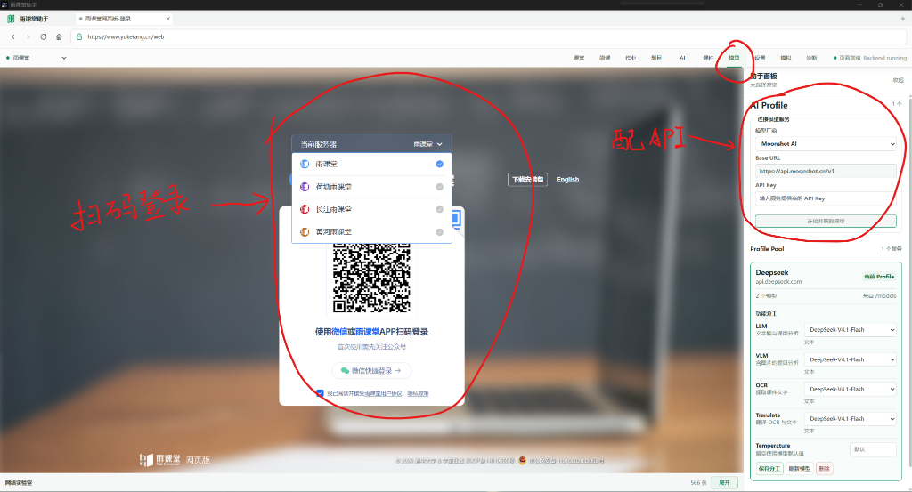
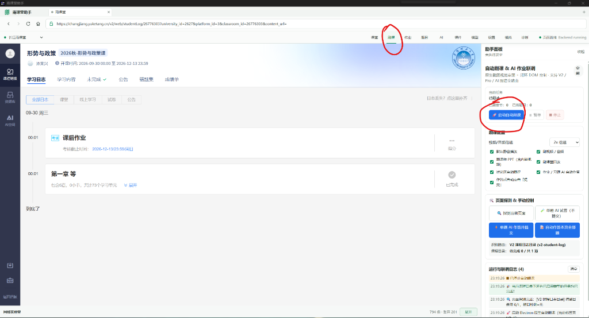
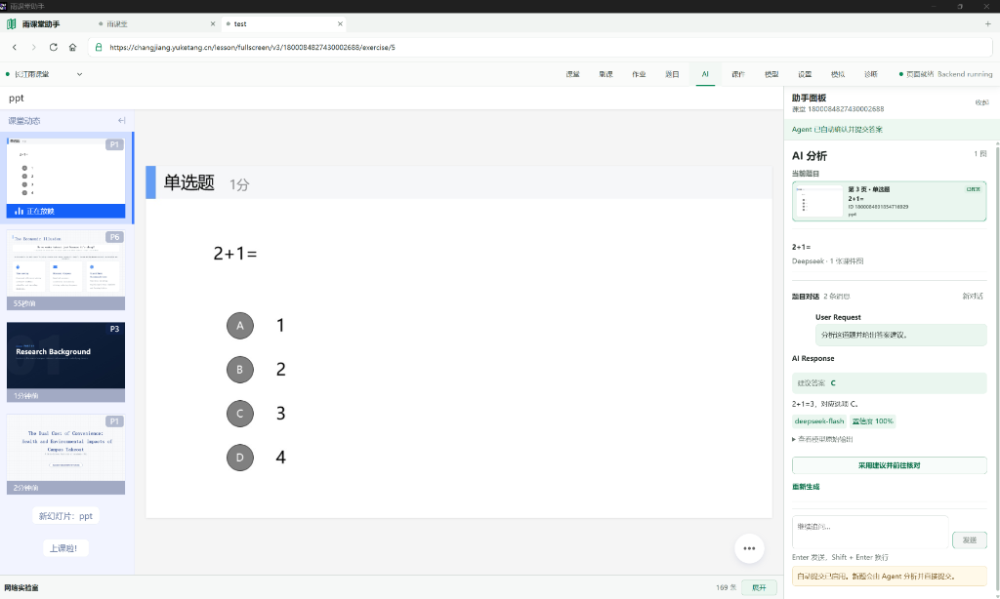

  

<h1 align="center">雨课堂助手</h1>

Windows 绿色便携助手，专注自动刷课与课堂自动化。

  
  
  

  <a href="https://github.com/Cyclohexi/yuketang-helper-auto/releases/latest"><strong>下载最新版 ZIP 便携包</strong></a> ·
  <a href="#quick-start">三步上手</a> ·
  <a href="#features">功能介绍</a> ·
  <a href="#faq">使用帮助</a>

解压即用 · 无需准备开发环境 · 支持应用内自动更新

基于 [ZaytsevZY/yuketang-helper-auto](https://github.com/ZaytsevZY/yuketang-helper-auto) 二次开发，延续课堂提醒、课件管理与 AI 辅助学习能力，并扩展课程自动化和便携版自动更新。

## 三步上手

1. **下载并解压**：打开[最新发行页](https://github.com/Cyclohexi/yuketang-helper-auto/releases/latest)，下载名称以 `Portable.zip` 结尾的附件，解压到可写文件夹。`update-win32-x64.json` 由客户端读取，无需手动下载。
2. **运行并登录**：双击 `YuketangHelper.exe`（或已改名的 `雨课堂助手.exe`），选择对应的雨课堂服务器，在网页中扫码登录。
3. **按需开启功能**：课程学习页面使用“刷课”面板；上课时使用题目、课件与 AI 面板。使用 AI 自动答题前，先在“模型”中配置服务并开启相应的自动作答选项。

首次配置 AI：在哪里填 API Key？

点击顶部“模型”，填写服务商提供的 **Base URL** 和 **API Key**，再选择模型。支持兼容 OpenAI 接口的服务；视觉分析需要所选模型支持图片输入，OCR 和翻译也可分别指定模型。

AI 调用可能产生服务商费用。不使用 AI 时，仍可使用登录、课件查看和视频自动播放等功能。

## 核心功能

### 自动刷课

面向课程学习页面，串联视频、讨论和学习单元切换。

| 功能         | 说明                                             | 状态   |
| ------------ | ------------------------------------------------ | ------ |
| 进度定位     | 分析课程目录，定位未完成的学习单元               | 支持   |
| 自动视频     | 自动播放、静音、设置倍速，播放结束后切换下一单元 | 支持   |
| 自动讨论     | 检测讨论单元，提取已有发言并填写、发布评论       | 支持   |
| 课件翻阅     | 自动翻页与停留                                   | 测试中 |
| 课后 AI 作业 | 识别作业题目、调用模型并尝试作答                 | 测试中 |

### 课堂自动化

面向正在进行的课堂，围绕题目、课件和课堂事件提供辅助。

| 功能               | 说明                                                   |
| ------------------ | ------------------------------------------------------ |
| 自动答题           | 检测新题，调用已配置的 AI 模型分析，并按设置作答与提交 |
| 提前查看课件与题目 | 浏览当前课堂已获取的课件和题目，包括老师尚未展示的页面 |
| 课件下载           | 查看历史课件，导出 PDF 或图片，支持批量管理            |
| 课堂提醒           | 新题、课件发布、上下课等事件可触发弹窗、声音或系统通知 |
| 自动进入课堂       | 检测正在上课的课堂，并按设置进入                       |
| OCR、翻译与提问    | 识别课件文字、翻译内容，或基于课件向 AI 提问           |
| 答案校验与补交     | 校验答案；符合当前课堂和平台条件时，可尝试补交         |

课件预览范围以当前课堂实际获取的内容为准；AI 分析与自动提交需要相应模型配置和功能开关。

  

## 版本更新记录

每次发布的变化按时间倒序记录。[完整更新日志](./changelog.md) · [全部发行版本](https://github.com/Cyclohexi/yuketang-helper-auto/releases)

### 未发布 · 统一配置目录与项目维护

- 当前源码及本地新构建程序统一使用 C 盘用户目录 `%LOCALAPPDATA%\YuketangHelper`，BAT 和 EXE 共用配置，更新程序不覆盖数据。
- 首次使用时复制旧数据并保留原件，调试模式使用独立数据目录。
- 增加项目维护记忆和同步检查，代码、说明及增量日志一起维护。

以上变化尚未包含在下方已发布的 v2.2.0 便携包中。

### v2.2.0 · 自动更新（2026-10-20）

第二个 Release，也是首次功能更新。

- 启动后自动检查新版，运行期间每 6 小时检查一次，也可手动检查。
- 在应用内下载新版，确认重启后自动替换便携程序。
- 保留登录状态、模型配置及 `ykt-helper-data` 本地数据。
- 增加更新包大小、SHA-256 校验，以及普通文件替换失败时的回滚。

> **首次升级**：v2.1.0 及更早版本需手动升级一次。先关闭旧程序，将原来的 `ykt-helper-data` 文件夹保留并放在新版程序旁；之后即可使用应用内更新。

[下载 v2.2.0 便携包](https://github.com/Cyclohexi/yuketang-helper-auto/releases/download/v2.2.0/YuketangHelper-v2.2.0-Windows-x64-Portable.zip) · [本次发布说明](https://github.com/Cyclohexi/yuketang-helper-auto/releases/tag/v2.2.0)

v2.1.0 · 首个 Release（2026-10-18）

提供 Windows x64 便携版，包含课堂助手、未完成单元定位、视频静音与倍速播放、讨论区互动等功能。

[查看 v2.1.0](https://github.com/Cyclohexi/yuketang-helper-auto/releases/tag/v2.1.0)

## 常见问题

支持哪些系统和雨课堂服务器？

当前提供 Windows 10/11 x64 便携版。客户端内置雨课堂、荷塘雨课堂和长江雨课堂三个入口；不同服务器与课程页面的可用功能可能存在差异。作业与考试列表目前仅支持荷塘雨课堂。

登录状态、API Key 和缓存保存在哪里？

当前源码及本地新构建程序将登录状态、模型配置和缓存统一保存在 `%LOCALAPPDATA%\YuketangHelper`（通常为 `C:\Users\你的用户名\AppData\Local\YuketangHelper`）。BAT 与 EXE 读取同一处，移动或更新程序不会替换此目录。首次启动会复制旧数据并保留原件，请先关闭旧程序。

已发布的 v2.2.0 及更早便携包仍使用程序旁的 `ykt-helper-data`。升级到采用固定目录的新版时，旧数据会在首次迁移时复制过去。登录失效时仍需重新扫码；跨电脑复制后，加密凭据可能需要重新填写。

配置保存在本地。使用 AI 功能时，相关题目文字、课件内容或截图会发送到你配置的模型服务进行处理。

以后如何更新？

v2.2.0 起支持应用内更新：点击顶部版本按钮检查并下载，下载完成后确认“重启更新”。检查和下载需要能够访问 GitHub，确认重启前不会主动关闭正在使用的程序。旧版首次升级方法见[版本更新记录](#version-history)。

AI 提示连接失败或 API Key 无效怎么办？

按服务商说明核对 Base URL、API Key、模型名称及账户额度。需要图片分析时，确认所选模型支持图片输入。API 调用费用由所配置的服务商收取。

自动刷课停留在某个单元怎么办？

先检查当前页面是否加载完成、相应刷课选项是否开启，再查看面板中的运行日志。讨论区缺少可用发言、课件尚未加载或课程页面发生变化，都可能需要手动处理；测试中的课件翻阅和课后作业功能请以实际结果为准。

## 开发与贡献

工程采用 Electron、Vue 3 和 TypeScript，使用 npm workspaces 管理桌面端、CLI 与共享业务包。目录结构、开发命令、测试和诊断说明见[开发者文档](./ykt-helper-win/README.md)。

[自动更新与发布](./ykt-helper-win/docs/auto-update.md) · [CLI 使用说明](./ykt-helper-win/docs/cli-assignments.md) · [反馈问题](https://github.com/Cyclohexi/yuketang-helper-auto/issues)

项目维护规则保存在 [AGENTS.md](./AGENTS.md)，每次同步按[维护清单](./ykt-helper-win/docs/project-maintenance.md)检查代码与受影响文档，并执行 `npm run sync:check`。

## 致谢

- [ZaytsevZY/yuketang-helper-auto](https://github.com/ZaytsevZY/yuketang-helper-auto)：桌面客户端与课堂助手基础。
- [Niuwh/yuketang-jiaoben](https://github.com/Niuwh/yuketang-jiaoben)：课程自动化、课件翻阅和讨论交互参考。
- [hotwords123/yuketang-helper](https://github.com/hotwords123/yuketang-helper)：早期浏览器扩展探索。
- [OneTHU](https://github.com/smartThise/OneTHU)：雨课堂接口协议研究。

## 免责声明

本项目遵循 [MIT 协议](./LICENSE)，仅供技术学习、桌面应用架构、接口协议与自动化测试研究交流。使用时请遵守学校规定和学术诚信要求，严禁用于代刷、代考、商业牟利或其他违规用途。

“雨课堂”相关名称及内容归其权利人所有，本项目为第三方工具，与雨课堂官方无关联。用户应自行判断使用场景，并承担使用产生的责任。
