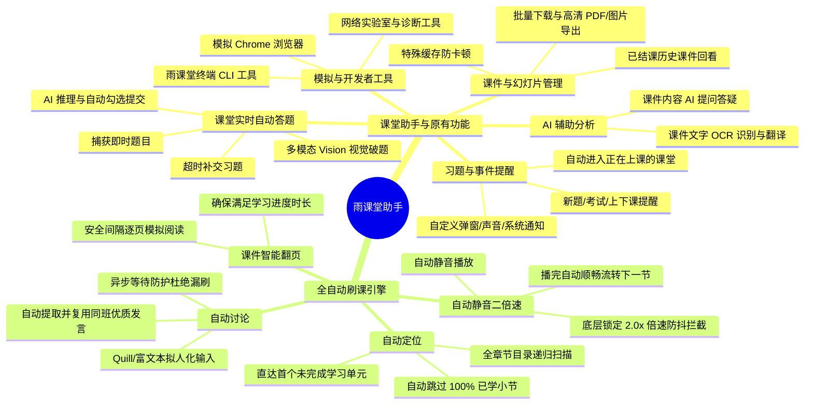

<p align="center">
  <a href="https://github.com/Cyclohexi/yuketang-helper-auto/releases">
    
  </a>
  <a href="https://github.com/Cyclohexi/yuketang-helper-auto/blob/main/LICENSE">
    
  </a>
  <a href="#">
    
  </a>
  <a href="#">
    
  </a>
  <a href="https://github.com/Cyclohexi/yuketang-helper-auto/pulls">
    
  </a>
</p>

<p align="center">
  
</p>

<h1 align="center">雨课堂助手 (Yuketang Helper AI)</h1>

<p align="center">
  <strong>现代化雨课堂智能全能客户端 · 课堂实时自动答题 · 全自动课程刷课流水线（自动定位 / 自动讨论 / 自动静音二倍速） · 绿色便携免安装</strong>
</p>

<p align="center">
  <a href="#-快速上手-quick-start">⚡ 快速上手</a> •
  <a href="#-功能总览">✨ 功能总览</a> •
  <a href="#1-课堂自动答题--原有完整功能原版全量功能保留">🎯 课堂自动答题与原版功能</a> •
  <a href="#2-全自动课程刷课流水线智能自动化">⚡ 全自动刷课功能</a> •
  <a href="#-大模型-ai-配置指南">🤖 AI 配置指南</a> •
  <a href="#-开发者指南">💻 开发者指南</a> •
  <a href="#-常见问题排查-faq">❓ 常见问题</a> •
  <a href="#-致谢与参考-acknowledgments">🤝 致谢参考</a> •
  <a href="#-免责声明-disclaimer">📜 免责声明</a>
</p>

---

## 📖 简介

本项目基于 [ZaytsevZY/yuketang-helper-auto](https://github.com/ZaytsevZY/yuketang-helper-auto) 进行全面二次开发与能力强化升级。

**本项目完整继承并保留了原项目的所有核心功能**（课堂监控、习题弹窗/声音提醒、自动进入上课、课件/幻灯片高清导出、文字 OCR 识别与翻译、AI 提问、开发者网络实验室、雨课堂 CLI 等），并全新自研了**课堂实时自动答题**与**全自动智能刷课流水线**（智能**自动定位**、**自动讨论**、**自动静音二倍速**、**课件自动翻页**与**多模态视觉 Vision AI 搜题**）。

> ⚠️ **温馨提示**：
> 1. 本项目仅供技术学习、前端逆向工程与自动化测试学术研究交流。
> 2. 使用大模型 AI 辅助答题可能消耗相应厂商的 Token / API 费用，请合理配置额度。
> 3. 本项目完全本地化运行，所有配置均存储在本地，不收集、不上报任何用户隐私与凭据。

---

## ✨ 功能总览



---

## 🎯 1. 课堂自动答题 + 原有完整功能（原版全量功能保留）

本客户端在桌面底层完整支持雨课堂 WebSocket 旁路监听与课堂协议，提供最完备的课堂辅助能力：

### 1.1 课堂实时自动答题 (In-Class Auto Answering)
- **实时题目捕获**：当教师在随堂上课中发布习题（单选、多选、填空、主观题）或开启限时考试时，系统毫秒级监听捕获。
- **AI 智能答题与自动提交**：
  - 自动将题干与选项传递给大模型进行语义解析与推理。
  - **自动勾选对应选项或填充文本**，并在安全延迟后**全自动提交**。
  - 支持在允许时间范围内对错过的习题进行**自动补交**。
- **多模态视觉 (Vision AI) 攻克加密字体**：
  - 针对雨课堂采用的动态混淆字体（WOFF/OTF 加密导致直接复制文本变为乱码），支持直接截取高清题目画幅，交由视觉多模态大模型直接“看图解答”，彻底攻破加密难题。

### 1.2 习题与课堂全方位提醒 (Event Notifications)
- **多维度强提醒**：在发布新题目、考试开始、课程开始与结束等关键节点，提供醒目弹窗、音频提示音与 Windows 系统桌面横幅通知。
- **自动进入课堂**：检测到当前有正在进行的雨课堂直播或上课，支持一键或**全自动进入课堂**，防止遗漏签到与考勤。

### 1.3 课件 (PPT) 与幻灯片全能查看与导出
- **课件离线缓存加速**：内置特殊渲染缓存机制，彻底解决校园网卡顿、课件幻灯片翻页加载慢的痛点。
- **高清导出与归档**：
  - 支持一键将课堂全部幻灯片批量下载并合成为**高清 PDF 文档**或**高质量图片包**。
  - 支持回看并导出**已经结束的历史课程**课件，复习复盘快人一步。

### 1.4 AI 课件提问、文字识别与翻译
- 支持对幻灯片内容进行一键 OCR 文字识别与多语言精准翻译。
- 支持针对当前课件内容直接向 AI 发起提问，快速理清难点知识。

### 1.5 浏览器模拟、开发者网络实验室与雨课堂 CLI
- **模拟 Chrome 行为**：完整模拟标准浏览器网络特征与请求标头。
- **开发者网络实验室**：提供网络诊断、WebSocket 报文捕获与事件模拟工具。
- **雨课堂 CLI (`ykt-cli`)**：提供高度模块化的命令行工具，方便通过终端或 Agent 自动化调度查询课程、课件与题目。

---

## ⚡ 2. 全自动课程刷课流水线（智能自动化）

面对大量的线上视频、课件与课后讨论，本助手提供了无需人工干预的全自动闭环流水线：

### 2.1 🧭 自动定位（智能目录扫描与断点续刷）
- **章节全景智能扫描**：进入课程后，程序底层自动递归解析整门课程的所有周次、章节与小节目录树。
- **精准断点直达**：智能判断每个节点的进度状态，**全自动跳过已经达到 100% 完成度的单元**，**直接定位并跳转至第一个未完成的学习单元**（无论是视频、课件还是讨论区），免去手动翻找的繁琐，杜绝遗漏漏刷。

### 2.2 🔇 自动静音二倍速（底层防抖锁定与流转）
- **自动静音**：检测到视频加载后第一时间自动静音，后台挂机静默学习，不干扰正常电脑使用。
- **稳定 2.0x 倍速播放（防抖锁定拦截）**：
  - 雨课堂网页自带脚本经常恶意检测并强制重置视频倍速至 1.0x。
  - 本助手在 Electron 注入层深度重构代理了 `HTMLMediaElement.prototype.playbackRate` 属性与事件，**对倍速重置进行底层拦截与防抖死锁**。
  - **稳定维持 2.0x 倍速（亦可配置更高倍速）**疾速推进，并在视频播放完毕触发 `ended` 后，**全自动顺畅切入下一小节**。

### 2.3 💬 自动讨论（同班发言智能复用与提交）
- **智能同班发言复用**：遇到讨论区单元时，自动扫描并提取当前课堂其他同班同学的高质量发言，避免千篇一律或提交无意义字符。
- **富文本与多编辑器兼容**：适配包含 Quill、Contenteditable 在内的各类富文本编辑器以及原生 textarea，拟人化填入并触发输入事件。
- **异步等待与防漏刷**：内置 DOM 异步加载监听与重试机制，防止因页面加载延迟误判为无讨论区而意外跳过，全自动完成跟帖发布。

### 2.4 📄 课件 (PPT) 智能逐页翻动
- 针对纯课件阅读单元，系统根据预设安全间隔时间逐页平滑翻阅，模拟真实阅读时长，确保达到平台规定的学习指标。

---

## ⚡ 快速上手 (Quick Start)

### 方式一：下载 Windows 绿色便携免安装版（强烈推荐普通用户）

> 💡 **无需安装 Node.js、npm 或 Python，解压即用！**

1. **前往下载**：
   在 [GitHub Releases 页面](https://github.com/Cyclohexi/yuketang-helper-auto/releases) 下载最新发行版：
   - 👉 **[点击直接下载 YuketangHelper-v2.1.0-Windows-x64-Portable.zip](https://github.com/Cyclohexi/yuketang-helper-auto/releases/download/v2.1.0/YuketangHelper-v2.1.0-Windows-x64-Portable.zip)**
2. **解压文件**：
   将下载好的 `.zip` 压缩包解压到本地任意目录（例如 `D:\Tools\YuketangHelper`）。
   > 📌 **建议**：请勿解压在带有只读属性或需管理员权限的根目录下（如 `C:\Program Files`）。
3. **启动运行**：
   打开解压后的文件夹，双击运行 **`雨课堂助手.exe`** 即可立即使用！数据将自动保存在同目录的 `ykt-helper-data` 文件夹内，绿色便携纯净。

---

### 方式二：克隆源码一键启动

如果你已克隆本仓库到本地，在根目录直接双击运行：
- **`启动雨课堂助手.bat`**：脚本将自动定位并启动内置 Electron 桌面客户端。

---

## 📸 界面预览与操作指引

### 1. 登录与身份绑定
打开应用后，通过微信或手机号扫码登录雨课堂官方网页（支持普通雨课堂、荷塘雨课堂及长江雨课堂等多校园环境）：

<p align="center">
  
</p>

### 2. 配置大模型 API
在左侧菜单进入“设置”，填入您的 API Key、Base URL 与对应的模型名称：

<p align="center">
  
</p>

### 3. 选择课程与自动化刷课
在课程列表页进入待学课程，点击右上角自动化按钮，助手将全自动扫描进度并启动刷课流：

<p align="center">
  
</p>

<p align="center">
  
</p>

---

## 🤖 大模型 (AI) 配置指南

本项目遵循通用 OpenAI 规范，支持目前市面几乎所有的兼容端点：

| API 提供商 | 推荐模型名 | 默认 Base URL | 获取 API Key 链接 |
| :--- | :--- | :--- | :--- |
| **DeepSeek** | `deepseek-chat` / `deepseek-reasoner` | `https://api.deepseek.com/v1` | [DeepSeek 开放平台](https://platform.deepseek.com/) |
| **月之暗面 Kimi** | `moonshot-v1-8k` / `moonshot-v1-32k` | `https://api.moonshot.cn/v1` | [Moonshot 开放平台](https://platform.moonshot.cn/) |
| **硅基流动 (SiliconFlow)** | `deepseek-ai/DeepSeek-V3` 等 | `https://api.siliconflow.cn/v1` | [硅基流动控制台](https://cloud.siliconflow.cn/) |
| **阿里云百炼** | `qwen-plus` / `qwen-max` / `qwen-vl-plus` | `https://dashscope.aliyuncs.com/compatible-mode/v1` | [阿里云百炼平台](https://bailian.console.aliyun.com/) |
| **OpenAI 官方** | `gpt-4o` / `gpt-4o-mini` | `https://api.openai.com/v1` | [OpenAI Platform](https://platform.openai.com/) |

> 💡 **提示**：若使用视觉答题（题干包含图片或公式渲染），请确保配置的模型支持 Vision 多模态输入（如 `gpt-4o`, `qwen-vl-plus` 等）。

---

## 💻 开发者指南

### 工程目录结构

```text
yuketang-helper-auto/
├── ykt-helper-win/            # 核心工程（Electron 主进程 + Vue 3 渲染端 + 刷课引擎）
│   ├── src/
│   │   ├── main/             # Electron 主进程源码
│   │   │   ├── course-brush/ # 自动化刷课状态机、目录解析与脚本生成器
│   │   │   └── ai/           # 多模态视觉答题与大模型交互
│   │   ├── renderer/         # 前端界面 (Vue 3 + Vite + Element Plus)
│   │   └── preload/          # 安全隔离注入脚本
│   └── tests/                # 刷课注入脚本与状态机契约测试 (Vitest)
├── static/                   # 界面截图与静态资源
└── 启动雨课堂助手.bat         # Windows 本地开发快速拉起脚本
```

### 本地编译与调试

```bash
# 1. 进入主工程目录
cd ykt-helper-win

# 2. 安装项目依赖
npm ci --include=dev --include=optional

# 3. 运行自动化契约测试 (39 Suites | 368 Tests)
npm test

# 4. 构建渲染前端
npm run build

# 5. 启动 Electron 桌面调试客户端
npm start
```

### 打包绿色免安装版

```bash
cd ykt-helper-win
npm run build:win:dir
# 生成的解压即用免安装包将位于 dist/win-unpacked/
```

---

## ❓ 常见问题排查 (FAQ)

<details>
<summary><strong>Q1: 为什么推荐绿色便携版 (Portable ZIP) 而非传统的 Setup 安装包？</strong></summary>

> **答**：传统安装包会将配置和缓存深度写入系统的 `%AppData%` 与注册表中，不仅卸载时容易残留，且在学校机房或公共电脑上往往受限于管理员权限。绿色便携版将所有运行时与数据完全封装在解压目录内的 `ykt-helper-data` 中，真正做到了“即解即用、拔盘即走、纯净无痕”。
</details>

<details>
<summary><strong>Q2: 每次关闭后重新打开需要重新扫码登录吗？</strong></summary>

> **答**：不需要。绿色便携版会将您的登录凭据和 Token 安全保存在软件同级的 `ykt-helper-data` 目录中。只要保留该目录，再次启动时会自动恢复登录态。
</details>

<details>
<summary><strong>Q3: 自动刷课时视频播放倍速老是被页面重置回 1 倍速怎么办？</strong></summary>

> **答**：本项目已在注入内核层深度代理了 `HTMLMediaElement.prototype.playbackRate` 属性并实现了防抖锁定逻辑，底层直接拦截雨课堂播放器的改写动作。请确保在助手设置中已勾选并设置目标倍速（建议设置为 2.0x ~ 3.0x，过高可能受网络带宽解码限制）。
</details>

<details>
<summary><strong>Q4: 自动讨论区单元为什么提示跳过或停留？</strong></summary>

> **答**：讨论区互动功能会自动检索本班同课堂其他同学的发言并智能复用发布。如果该门课程刚开课、讨论区暂无任何同学发表评论，系统会在等待超时后安全跳过，以防死循环或提交空内容违规。
</details>

<details>
<summary><strong>Q5: AI 答题提示“网络连接失败”或“API Key 无效”？</strong></summary>

> **答**：请核对设置中的 **Base URL** 是否完整（通常需要以 `/v1` 结尾，末尾无需多余斜杠），并确认 API 账户是否有充足的可用额度。若直连受限，可在软件中开启网络代理。
</details>

---

## 🤝 致谢与参考 (Acknowledgments)

本项目由衷感谢开源社区的探索与无私奉献，尤其向以下先驱项目及作者致以诚挚敬意：

1. **[ZaytsevZY/yuketang-helper-auto](https://github.com/ZaytsevZY/yuketang-helper-auto)**
   - 感谢原作者开源的桌面客户端架构底座，提供了 Electron 桌面工程体系、雨课堂 WebSocket 旁路监听、作业/考试详情还原以及加密字体解析的基础。
2. **[Niuwh/yuketang-jiaoben](https://github.com/Niuwh/yuketang-jiaoben)**
   - 感谢作者“风之子”开源的雨课堂刷课助手油猴脚本，为本项目的课程刷课自动化逻辑、PPT 翻页判定、讨论区互动交互及 DOM 选择器适配提供了宝贵的参考与启发。
3. **[hotwords123/yuketang-helper](https://github.com/hotwords123/yuketang-helper)**
   - 感谢雨课堂助手扩展的早期奠基工作。
4. **[OneTHU](https://github.com/smartThise/OneTHU)**
   - 感谢社区早期对清华雨课堂接口协议反向工程的探索。

---

## 📜 免责声明 (Disclaimer)

1. **用途限制**：本项目仅供前端逆向工程、Electron 桌面应用架构、自动化契约测试及多模态 AI 视觉辅助等学术与技术研究交流使用。
2. **规范诚信**：严禁将本项目用于任何违背学术诚信、学校管理规章制度的行为，严禁用于任何商业牟利、代刷代考或非法用途。
3. **责任界定**：任何个人或组织使用本项目所产生的一切直接或间接后果，均由使用者自行承担，本项目作者及贡献者不承担任何法律责任或连带责任。
4. **知识产权**：“雨课堂”是清华大学及学堂在线相关权利人的注册商标，本项目仅为第三方开源学习工具，与雨课堂官方无任何关联或商业合作。

---

<p align="center">
  Made with ❤️ by Open Source Contributors • Licensed under <a href="LICENSE">MIT</a>
</p>
